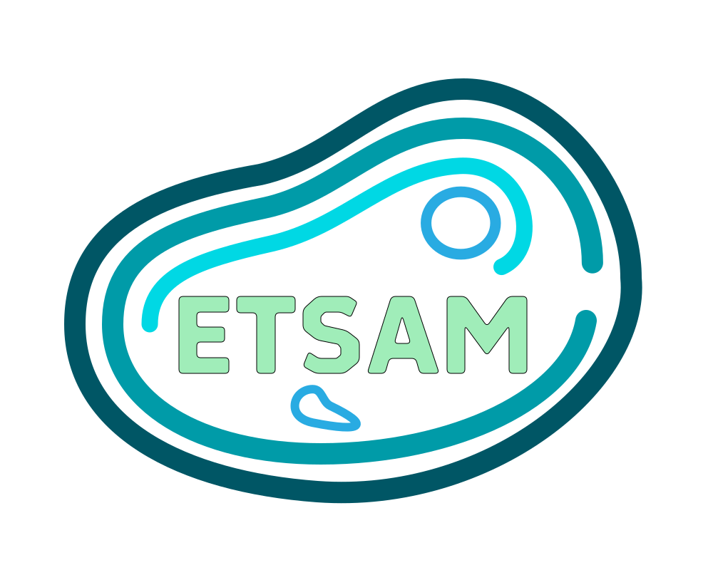

# ETSAM: Effectively Segmenting Membranes in cryo-Electron Tomograms

[](https://doi.org/10.1038/s41467-026-77962-7)
[](https://jianlin-cheng.github.io/ETSAM/)
[](https://doi.org/10.7910/DVN/K4JKCW)
[](https://doi.org/10.5281/zenodo.17571925)

Cryogenic Electron Tomography (cryo-ET) is an emerging experimental technique to visualize cell structures and macromolecules in their native cellular environment. Accurate segmentation of cell structures in cryo-ET tomograms, such as cell membranes, is crucial to advance our understanding of cellular organization and function. However, several inherent limitations in cryo-ET tomograms, including the very low signal-to-noise ratio, missing wedge artifacts from limited tilt angles, and other noise artifacts, collectively hinder the reliable identification and delineation of these structures. In this study, we introduce ETSAM - a two-stage SAM2-based fine-tuned AI model that effectively segments cell membranes in cryo-ET tomograms. It is trained on a diverse dataset comprising 83 experimental tomograms from the CryoET Data Portal (CDP) database and 28 simulated tomograms generated using PolNet. ETSAM achieves state-of-the-art performance on an independent test set comprising 10 simulated tomograms and 10 experimental tomograms for which ground-truth annotations are available. It robustly segments cell membranes with high sensitivity and precision, achieving a more favorable precision–recall trade-off than other deep learning methods.

# ETSAM Pipeline 


(A) shows the pipeline of the two-stage ETSAM. (B) shows the network architecture of the ETSAM block used in both stage 1 and stage 2.

# Requirements
## Hardware Requirements
<ins>ETSAM requires:</ins>
- a NVIDIA GPU with atleast 2GB VRAM, 4GB VRAM recommended. 
- atleast 16GB CPU RAM, recommended 32GB.

<ins>Tested on</ins>
- Intel® Core™ i7-14700K
- NVIDIA GeForce RTX 4070 with 12GB VRAM
- 32 GB DDR5 CPU RAM

## Supported Platforms
ETSAM supports **Linux and Windows with an NVIDIA GPU** (tested on Fedora 43, Arch Linux and Windows 11).

_Other configurations (macOS, AMD or Intel GPUs) may work, but require testing by users; contributions are welcome. For example, AMD GPUs may work with an [AMD specific PyTorch](https://pytorch.org/get-started/locally/) installed in the etsam environment by the conda constructor installer post-script: [installer/post_install.sh](installer/post_install.sh)._

# Installation 
Install ETSAM with one command. 

On Linux:
```bash
curl -fsSL https://jianlin-cheng.github.io/ETSAM/install.sh | sh
```
On Windows, in PowerShell:
```powershell
irm https://jianlin-cheng.github.io/ETSAM/install.ps1 | iex
```
It installs ETSAM in a separate python environment with dependencies and model checkpoints required to run it. Everything goes into one folder (Linux: `~/etsam_env`, Windows: `%USERPROFILE%\etsam_env`). It also makes the `etsam` command available in new terminals thereafter. Detailed instructions and various other installation methodologies are available in https://jianlin-cheng.github.io/ETSAM/installation.

# Usage
### CLI
```bash
etsam input_tomogram.mrc --output-dir results/
```
We have provided detailed tutorial on how to use ETSAM CLI in https://jianlin-cheng.github.io/ETSAM/tutorial/. 

Information on advanced usage of ETSAM CLI is available here: https://jianlin-cheng.github.io/ETSAM/advanced/

### UCSF ChimeraX Plugin
- In ChimeraX, open **Tools ▸ More Tools…**, search for **ETSAM** and click **Install**. 
- Once installed Open **Tools ▸ Volume Data ▸ ETSAM Membrane Segmentation** to select and segment an loaded tomogram volume.

You can read more about installing and how to use the ChimeraX plugin over here: https://jianlin-cheng.github.io/ETSAM/chimerax/

### Napari Plugin
- In napari, open **Plugins ▸ Install/Uninstall Plugins…**.
- Search for **ETSAM**, click **Install** next to *napari-etsam*, and restart napari.

You can read more about installing and how to use the ChimeraX plugin over here: https://jianlin-cheng.github.io/ETSAM/napari/


# Training and Evaluation
Refer [Training](https://jianlin-cheng.github.io/ETSAM/training) and [Evaluation](https://jianlin-cheng.github.io/ETSAM/evaluation) section of the documentation for more details.

# Cite
```
@article{Selvaraj2026,
    author  = {Selvaraj, Joel and Cheng, Jianlin},
    title   = "{ETSAM}: effectively segmenting cell membranes in cryo-electron tomograms",
    journal = {Nature Communications},
    year    = {2026},
    doi     = {10.1038/s41467-026-77962-7},
    url     = {https://doi.org/10.1038/s41467-026-77962-7},
    issn    = {2041-1723}
}
```
